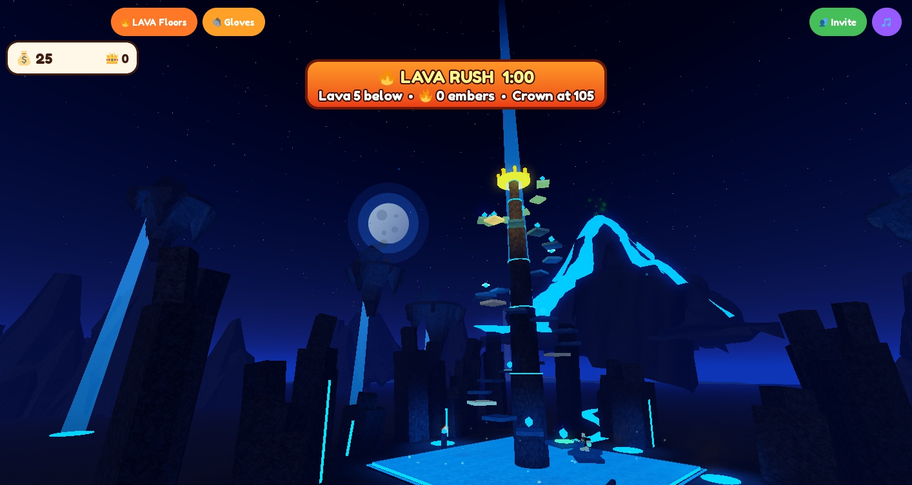
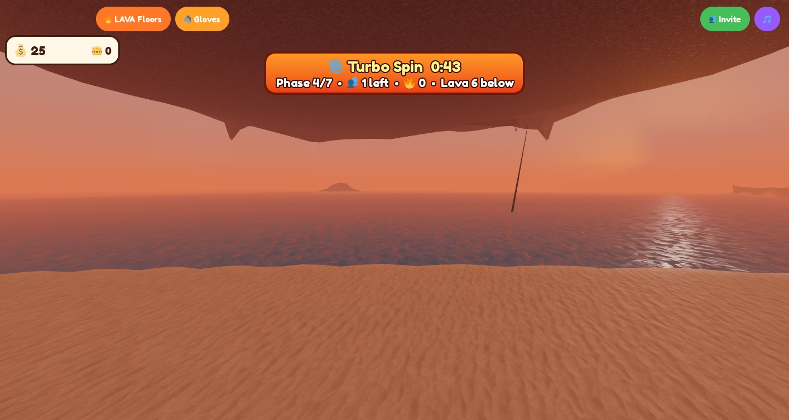

# LAVA Floors


A Roblox party game. Everyone spawns on a floating floor over the lava, and the floor keeps changing
under you. Survive every phase to win the round.

## How a round works

Each round is 7 phases. Every phase the floor:

1. **Spins.** Everyone standing on it gets carried around.
2. **Grows.** The first two phases slide out a new outer ring (5x5 → 7x7 → 9x9).
3. **Breaks tiles.** A few tiles wear out over the phase (they darken, crack and shake) and then shatter.
4. **Rises.** The floor goes up and the lava follows. In the later phases the outer ring stays behind as a
   step, so it shrinks back down like a pyramid (9x9 → 7x7 → 5x5 → 3x3).

Don't camp: any tile you stand on starts wearing out, and after about 6 seconds it cracks under you. You can
spend 40 coins (earned in rounds) to **raise** your tile for 10 seconds (E, Y on a controller, or the RAISE
button). A raised tile doesn't wear.

If you fall while others are still going, the camera swings out to spectate the floor until the round ends.
When it does, everyone sees a winner banner with confetti over the winners.

Whoever is still standing after phase 7 gets crowned. With two or more players, the last one standing wins
straight away, so nobody waits out a long round after falling. You can shove other players off, and every so often
one supply drop pops in far from everyone, floating out of reach under a beam of light: jump to grab it before its
ring shrinks away. Drops are fruit: banana (speed), pineapple (super jump), blueberry (shield), coconut (rescue) and
watermelon (berry bag). Strawberries on the tiles are bonus points if you survive. Fruit hats are in the shop.

Every round also rolls a twist (Low Gravity, Turbo Spin, Hole Party, Speed Rush, Shield Party, Drop Party, Hot Potato)
and a world theme (Sunset, Blue Inferno, Purple Moon, Starry Night).

The arena sits inside a volcano crater. The lobby is on the crater floor, a wide gap in the rim faces the town so
you can walk out onto the island, and the grid climbs the inside of the crater: the last rise lifts it just over the
glowing rim, so the winners escape the volcano. Every rise makes the volcano rumble and throw rocks into the lava.

Friend deal: tap 👥 Invite. When a friend joins from your invite you both get 150 coins (once per friend; the
welcome gift once per account; up to 5 invite rewards a day; accounts under 3 days old don't pay the inviter). If you
have left, the reward waits for your next visit. Playing in the same server as a friend, or someone you invited, gives
+25% coins every round, shown by the green "Friend boost" badge. Numbers live in `FriendDeal` in SkySproutConfig.
In Studio, set the workspace attribute `StudioFakeReferrer` to a test player's UserId to simulate an invite.

Round extras:
- Final showdown: when two climbers (or two Duos teams) are left the lava surges and shoves hit harder.
- Twist vote: at the end of a round everyone votes on one of three twists for the next round.
- Bots fill rounds that start with 1-3 real climbers (up to 4, labelled with a robot); they hop between safe tiles,
  fall with the floor or the lava and can be shoved off. If no real climbers are left, standing bots win.
- Duos twist: everyone is paired (friends first, then players, then bots); teammates share an outline colour, can't
  shove each other, and the last team standing wins (both teammates are crowned).

Progression and live-ops:
- Daily challenges: three a day for everyone (CFG.Challenges), paid on completion; shown in the Challenges panel.
- Codes: typed into the Challenges panel, once per account (CFG.Codes, server-only). Launch codes LAVA, VOLCANO, ESCAPE.
- Titles over your head from total crowns (CFG.Titles), and a gold pillar with fireworks over every winner.
- Lava Chest: every round fills a bar on the result card (12 for playing, up to 30 for height, +15 survive, +30 crown).
  At 150 it opens for 100 coins; every 5th chest gives 300. The card always says how close the next chest is
  ("one more round to the chest!"). Fixed coins, nothing random or paid. Numbers are `Chest*` in CFG.
- Round awards: with 2+ players the winner banner also names a Top Climber (best non-winner), Shove Champ, Berry
  Picker and Fruit Grabber. One award per player, only for something they did, no coins.
- Warm-up Hop: a timed stepping-stone run over practice lava beside the lobby plaza, for anyone waiting on a round.
  Falling in sends you back to the start; the finish sign shows the server's fastest run. No coins.
- Near miss: knocked out one or two rises from the crown, the result card says "😱 SO CLOSE! N rises left".
- Cheers: anyone not climbing (knocked out or sitting a round out) gets a bar of six preset emoji. A tap floats
  the emoji with your name up everyone's screen. No typing; the server allows one every 1.2 s (CFG.CheerCooldown).
- Accessibility: red warning plates also carry a ⚠ symbol (not colour alone), and Roblox's Reduce Motion setting turns
  off camera shake, the FOV kick, speed streaks, tile wobble and blinking (warnings stay on, steady).
- Weekly Top Climbers board in the lobby: crowns won this week across all servers (OrderedDataStore
  `LavaWeeklyCrowns_v1`, one scope per week), merged with the climbers in the server. Resets Monday 00:00 UTC.
- Seasonal events (SkySproutConfig.Events): Spooky Eruption (Oct 20 - Nov 3) and Frostfire Festival (Dec 18 - Jan 4)
  give +50% round coins, favour a theme, show a top bar pill, and Frostfire brings snow. Force one in Studio with
  the workspace attribute `StudioForceEvent`.

| | |
|---|---|
|  |  |
|  |  |

## Project layout

```
Assets/Scripts/Server   ServerScriptService (round loop, profiles, shop, passes)
Assets/Scripts/Shared   ReplicatedStorage (config, grid schedule, themes, HUD modules)
Assets/Scripts/Client   StarterPlayerScripts (HUD, effects, input)
Packages/TopbarPlus     Top bar buttons (third party, see below)
Place/LavaFloors.rbxl   The map, lighting and models
Media/                  Screenshots
```

The main pieces:

- `SkySproutLavaService` runs the rounds: queue, phases, lava, pickups, payouts.
- `LavaGrid` is the floor schedule. Where every tile is depends only on the server clock, so all clients see the
  same floor without the server sending any movement.
- `SkySproutLavaClient` moves the tiles locally, carries your character with the tile you stand on, and draws the
  round HUD.
- `LavaThemes` holds the per-round lighting and colours.

All the tuning (grid size, phase timing, rewards, boosts) is in the `CFG` table at the top of
`SkySproutLavaService`.

## Building

Open `Place/LavaFloors.rbxl` in Roblox Studio. The scripts are already in it.

The map (arena, floor, lights, backdrop, fruit) is built by scripts when the game runs. A preview copy is saved
in the place so the edit view isn't empty; the game clears it on start and builds a fresh one. After changing
the build code, refresh the preview from the command bar:

```lua
local m = game.ServerScriptService.SkySproutLavaService:Clone(); m.Parent = game.ServerScriptService; require(m).BuildPreview(); m:Destroy()
```

(It requires a fresh copy because Studio caches modules: a plain `require` keeps running the old code after you
edit the script.)

The island itself (terrain, palms, flower bushes, tiki torches and clouds) is regular scenery saved in the place:
`Floor_1.IslandDecor`, with the source models in `ServerStorage.IslandAssets`.

To work on the scripts from the repo, serve them with [Rojo](https://rojo.space):

```
rojo serve
```

## Monetization

Everything that affects play can be earned. Robux only buys coins (which you can also earn), cosmetics and
VIP comfort perks. Nothing is random and there are no fake timers.

| What | Type | Where it's set |
|---|---|---|
| ⭐ VIP: VIP tag (head + chat), Golden Apple hat, golden shimmer, 2x daily reward, +25% round coins | Subscription | `VipSubscriptionId` |
| 🎟️ Lava Pass Premium: unlocks the premium track (extra coins, Dragon Fruit and Star Fruit hats) | Game pass | `LavaPassPremiumId` |
| 2x Lava Coins | Game pass | `DoubleLavaPassId` |
| Aurora Gloves | Game pass | `PassId` |
| Coin packs: 100 / 500 / 2,000 / 6,000 | Developer products | `ProductIds.Coins*` |
| 💖 Tips: 25 / 100 / 500 / 1,000 Robux, shown on the Top Supporters board | Developer products | `ProductIds.Tip*` |
| 📺 Watch an ad for 100 coins (only shown when Roblox has an ad for that player) | Rewarded video | uses `ProductIds.Coins100` |

The free Lava Pass track (20 tiers, XP from playing, surviving, crowns and strawberries) is free for everyone.

## Before publishing

- Create the subscription, passes and products above on the Creator Dashboard and paste the IDs into
  `SkySproutConfig` (anything left at 0 or "" stays hidden in game).
- Turn on Price Optimization for the passes and products, and set a private server price.
- Rewarded video ads only start once the game is public and meets Roblox's eligibility rules.
- Set the badge IDs in `SkySproutConfig`.
- Set Lighting → Technology to **Future** in Studio.

## Credits

- [TopbarPlus](https://github.com/1ForeverHD/TopbarPlus) v3.5.0 by ForeverHD, used under the
  [Mozilla Public License 2.0](https://mozilla.org/MPL/2.0/). It's included unchanged in `Packages/TopbarPlus`.
- Volcano and peak models from the Roblox Creator Store.
- Fruit models were made with Roblox Studio's built-in mesh generator. They live in the place file under
  `ReplicatedStorage.FruitModels`.
