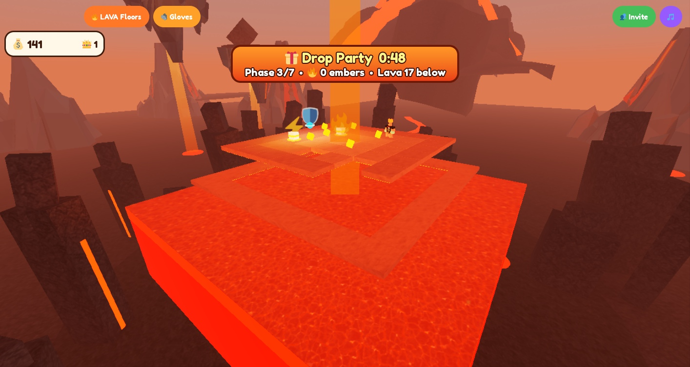
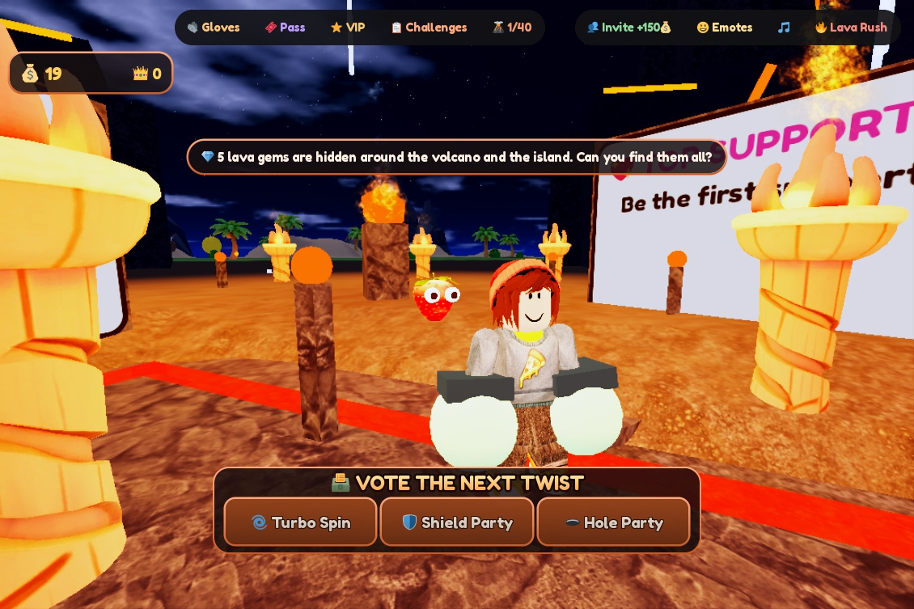
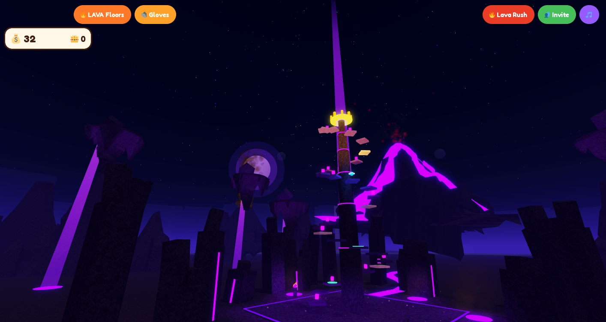
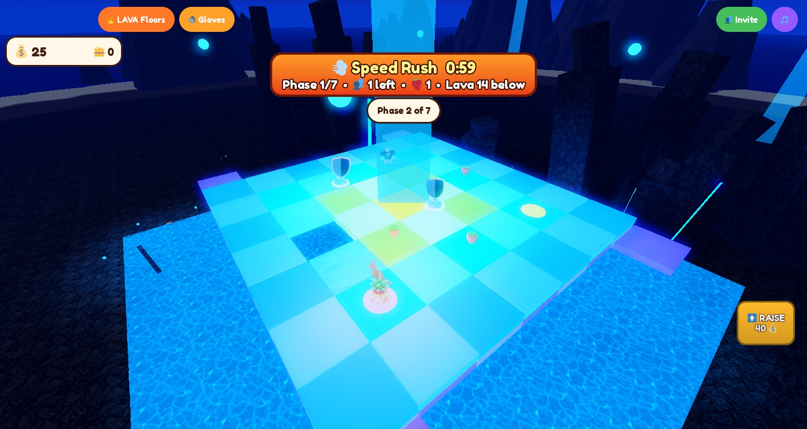
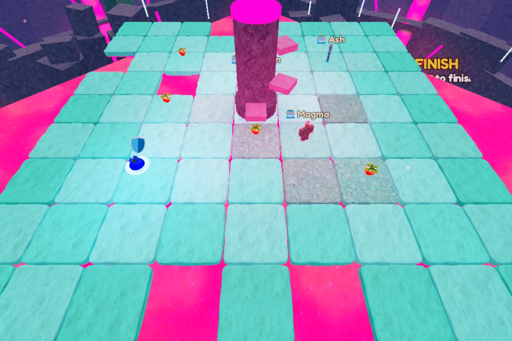

# LAVA Floors



A Roblox party game. Everyone spawns on a floating floor over the lava, and the floor keeps changing
under you. Survive every phase to win the round.

## How a round works

Each round is 3 phases of 10 seconds. Every phase the floor:

1. **Spins.** Everyone standing on it gets carried around.
2. **Grows.** Phase 1 slides out two new rings at once (5x5 → 9x9).
3. **Breaks tiles.** A few tiles wear out over the phase (they darken, crack and shake) and then shatter.
4. **Rises.** The floor goes up 23 studs and the lava follows. In phases 2 and 3 the outer rings stay behind as
   steps, so it shrinks back down like a pyramid (9x9 → 5x5 → a 3x3 finale).

A basalt pillar stands on the centre tile and rides it, blocking the view across the grid, so you can't always
see who's coming round the other side. The centre tile never drops and nobody is placed on it. Four light ledges
spiral up the pillar to a strawberry on the cap (King of the Pillar); standing up there wears the centre tile like
anywhere else, so nobody can camp it.

Don't camp: any tile you stand on starts wearing out, and after about 6 seconds it cracks under you. You can
spend 40 coins (earned in rounds) to **raise** your tile for 10 seconds (E, Y on a controller, or the RAISE
button). A raised tile doesn't wear.

Jumps are forgiving: a jump pressed up to 0.2 s after your tile drops away (or you step off) still jumps, and one
pressed up to 0.12 s before you land jumps as soon as you touch down. One jump per landing, and not right after a
shove, so shoves still land (`COYOTE` / `BUFFER` in SkySproutLavaClient).

Tips only come when you lose (owner's call): there are no coach cards, lobby tips or hint pop-ups. When you fall, a
short line says why and how to avoid it next time (shoved, your tile crumbled from standing still,
a tile dropped away, the edge was left behind, the hot potato, or you slipped). If you fall while others are still going, the camera swings out to spectate the floor until the round ends; the
◀ ▶ buttons switch to following any climber still in the round, players or bots. On a controller, L1 / R1 switch
who you follow and X sends the strawberry gift; when the twist vote opens, the selection starts on the first option
so the D-pad and A vote right away.
When it does, everyone sees a winner banner with confetti over the winners.

Whoever is still standing after phase 3 gets crowned. With two or more players, the last one standing wins
straight away, so nobody waits out a long round after falling. You can shove other players off (not during the
get-ready seconds before the floor moves, and not someone who landed on the grid under 2 s ago, `JoinGrace`), and every so often
one supply drop pops in far from everyone, floating out of reach under a beam of light: jump to grab it before its
ring shrinks away. Drops are fruit: banana (speed), pineapple (super jump), blueberry (shield), coconut (rescue) and
watermelon (berry bag). Strawberries are a risk: only 2 a round (`Berries`), all on the outer ring that grows in during
phase 1 and drops away in phase 2, plus one on top of the pillar. Each is 4 coins (`EmberCoins`) if you survive.
Supply drops come every 20 s (`DropEvery`), or every 12 s in the bonus rounds: every world theme except Sunset
(`ThemeDropEvery`); their countdown says "🐾 Bonus round". A drop is never the same fruit as the one before it. Fruit hats are in the shop, and so are 🐾 fruit
buddies: little fruit pets with googly eyes that float by your shoulder and bob along (Strawberry 600 to Coconut 3000
coins, all earnable; tap again to send it to rest; Reduce Motion keeps it still). `Pets` in SkySproutConfig,
`PetSize`/`PetOffset` in CFG, saved as `Pet`/`OwnedPets`. Four more buddies can't be bought, only found: in every
world theme except Sunset, that theme's lost buddy floats in a bubble on the outer ring (Inferno Berry in Blue
Inferno, Moon Banana in Purple Moon, Star Buddy in Starry Night, Candy Dragon in Candy Crater), each with its own
glow. The first climber to grab it keeps it and it starts following them; grabbing one you already own pays 40 coins
(`BuddyFindCoins`). Their shop cards say where to find them. Finding all four unlocks the title 🐾 Buddy Collector,
and "Grab 1 lost buddy" is one of the daily challenges (so are "Cheer 3 times from the sidelines", "Send 1 strawberry
gift", "Grab 2 shield orbs", "Survive 2 twist rounds", "Vote for the next twist 3 times", "Knock 2 climbers off the floor" (bots count
too) and "Play in 3 different worlds"). Being crowned in 5 different twists unlocks 🌀 Twist Tamer
(`TitleTwists`, saved as `TwistWins`), and being part of 3 escape parties unlocks 🤝 Team Player (`TitleParties`, saved
as `EscapeParties`). Playing in all five worlds (ever, not in one day) unlocks 🌍 World
Traveler (saved as `WorldsSeen`).



Every round also rolls a twist (Low Gravity, Turbo Spin, Hole Party, Speed Rush, Shield Party, Drop Party, Hot Potato,
Duos, Big Heads, Mega Shoves, Quick Crumble, Bouncy, Shove Frenzy, Slow-Mo, Fast-Forward, Magnet Hands) and a world theme (Sunset, Blue Inferno, Purple Moon, Starry Night, and the bright daytime Candy Crater: mint tiles
over strawberry-pink lava). Big Heads is just a look: every
climber's head (bots too) grows 1.75x for the round, and speed, jumps and shoves stay the same. Mega Shoves makes shoves fly 1.6x as far
(`MegaShove`; capped at `ShoveMax` 110 so the showdown boost can't push past the client's 120 limit) and pushes bots one
tile further. Bouncy raises everyone's round jump from 48 to 58 (`BouncyJumpPower`, about 8.6 studs instead
of 5.9), and a super-jump pickup still goes higher. Shove Frenzy halves the shove cooldown for everyone (0.4 s instead
of 0.8, `FrenzyShoveCooldown`). Slow-Mo makes each phase last 13 s instead of 10 (`SlowMoPhaseTime`), so the floor
spins, grows and drops 1.3x slower and the lava keeps pace: a gentler round. Fast-Forward (rarer) does the opposite:
8 s phases (`FastForwardPhaseTime`), a 24 s round for skilled climbers. Quick Crumble (rarer) makes a tile you stand on crack in 0.6x the time (`QuickCrumble`), so
keep moving. Magnet Hands flips every shove into a pull: the other climber flies toward you (often right past
you), and a shoved bot slides 1.6 tiles your way, so pulling someone across a hole drops them in.

The arena sits inside a volcano crater. The lobby is on the crater floor, a wide gap in the rim faces the town so
you can walk out onto the island, and the grid climbs the inside of the crater: the last rise lifts it just over the
glowing rim, so the winners escape the volcano. Every rise makes the volcano rumble and throw rocks into the lava.

Friend deal: tap 👥 Invite. When a friend joins from your invite you both get 150 coins (once per friend; the
welcome gift once per account; up to 5 invite rewards a day; accounts under 3 days old don't pay the inviter). If you
have left, the reward waits for your next visit. Playing in the same server as a friend, or someone you invited, gives
+25% coins every round, shown by the green "Friend boost" badge. Numbers live in `FriendDeal` in SkySproutConfig.
In Studio, set the workspace attribute `StudioFakeReferrer` to a test player's UserId to simulate an invite.

Spawn with friends: joining a friend who's in the lobby puts you 5 studs beside them (`FriendSpawnGap`), only on solid
ground that isn't lava. If they're climbing, you get a notice that you'll be in the next round together, and your
camera starts following them ("👀 Watching your friend …", with the 🍓 gift ready; any move key hands it back). In Studio,
the workspace attribute `StudioFakeFriends` makes every test player a friend, and the server prints `[friends]` lines.

Round extras:
- Final showdown: when two climbers (or two Duos teams) are left the lava surges and shoves hit harder.
- Twist vote: at the end of a round everyone votes on one of three twists for the next round. Half the time the third
  choice is 🎲 Surprise!: if it wins, the next twist is one that wasn't on the ballot, kept secret until the countdown.
- Bots fill rounds that start with 1-3 real climbers (up to 4, labelled with a robot); they hop between safe tiles,
  fall with the floor or the lava and can be shoved off. If no real climbers are left, standing bots win.
  Every bot win in a row makes them a little clumsier (`BotEase`, up to +0.30 mistake chance); a player win
  sharpens them back up. They never get better than the base `BotMistake`.
  In the themed worlds the bots are named to match (Candy Crater: Gumdrop, Sprinkles, Taffy…; Starry Night: Comet,
  Nova…; `BotNamesByTheme`); Sunset keeps the volcano names (`BotNames`).
- Duos twist: everyone is paired (friends first, then players, then bots); teammates share an outline colour, can't
  shove each other, and the last team standing wins (both teammates are crowned). Each team has a name that matches
  its colour (💧 Team Splash, 🌸 Team Blossom, 🐸 Team Froggy, ⚡ Team Zap, 🔮 Team Wizard, 🦊 Team Fox).

Progression and live-ops:
- Daily reward: coins once a day on joining, climbing 25 → 300 over 7 days you play (`DAILY` in
  SkySproutShopService). Missing a day pauses the ladder instead of resetting it, so there's no "come back or lose it"
  pressure. A 7-day calendar card shows collected days, today and the next reward. It only appears once you've been
  out of a round for 3 s, never over the floor, and comes back (up to 3 times) if a round cuts it short.
- Welcome back: coming back after 7 or more days away adds a one-time 100-coin gift to that day's daily reward
  ("👋 Welcome back! We missed you"), flat for everyone (`WELCOME_BACK_DAYS` / `WELCOME_BACK_COINS` in
  SkySproutShopService). New players don't get it; it's for returning players only.
- Daily challenges: three a day for everyone (CFG.Challenges), paid on completion; shown in the Challenges panel.
- Codes: typed into the Challenges panel, once per account (CFG.Codes, server-only). Launch codes LAVA, VOLCANO, ESCAPE.
- Titles over your head (CFG.Titles), and a gold pillar with fireworks over every winner. Crown titles unlock with
  total crowns; 🔶 Gem Hunter (every lava gem), 🎁 Chest Cracker (5 Lava Chests) and 🍓 Kind Climber (5 strawberry
  gifts) unlock with other achievements. The 🏷️ button in the Challenges panel picks which unlocked title to show
  (or Auto for the best crown title, or none). Saved as `Title` in the profile.
- Music: two free tracks Roblox licenses for experiences (APM Music, Creator Store): the island tune "Hawaiian
  Parkour (b)" in the lobby and driving drums, "Natural Disaster" (climax), for the climb. The drums start from the
  top every round, play 5% faster with each lava phase and a little louder in the last one, then fade back to the
  lobby tune (also when a round ends early). Climbers and watchers hear the same build-up. The 🎵 / 🔇 button is saved with your profile (`MusicOff`),
  so muted music stays muted the next time you join.
- Victory emote: the 🏆 "When I win" button in the 😀 Emotes panel cycles through the ten free emotes (Wave, Cheer,
  Laugh, Point, Dance, Groove, Shuffle, Clap, Happy, Bop; all Roblox-owned animations) and previews each one; your
  pick plays when you're crowned (Cheer by default). Saved as `WinEmote` (CFG.WinEmotes).
- Jump styles: each jump plays one of the jumps from Roblox's own animation packs (Cartoony, Ninja, Superhero,
  Stylish, Toy, Bubbly, Astronaut, Levitation, Rthro, Robot, Mage, Knight), picked at random each time you land.
  Just a look: jump height and timing don't change.
- First crown of the day: your first crown each day (UTC) pays 50 coins on top ("👑 First crown today!"), the same
  for everyone, after VIP and 2x multipliers. `FirstCrownCoins` in CFG, saved as `FirstCrownDay`.
- Round milestones: your 10th, 25th, 50th, 100th, 250th, 500th and 1000th rounds come with a thank-you gift (25 →
  300 coins, "🎉 That was your 50th round!"), flat for everyone (`RoundMilestones` in CFG, saved as `RoundsPlayed`).
- Escape party: when 3 or more players are crowned in the same round, each of them gets 15 coins on top ("🤝 Escape
  party!"), flat and the same for everyone. `EscapePartyMin` / `EscapePartyCoins` in CFG.
- Lava Chest: every round fills a bar on the result card (12 for playing, up to 30 for height, +15 survive, +30 crown).
  At 215 it opens for 100 coins; every 5th chest gives 300. The card always says how close the next chest is
  ("one more round to the chest!"). Fixed coins, nothing random or paid. Numbers are `Chest*` in CFG.
- Server goal: every rise a real player reaches fills one shared bar (top bar pill: a trophy and "12/40"). When it
  fills, everyone who climbed since the last one gets 30 coins and a new bar starts. `GoalRises` / `GoalCoins` in CFG.
- Underdog shield: knocked out 3 rounds in a row, you start the next round in a 15 s bubble shield (shoves only).
  Surviving resets it. `UnderdogAfter` / `UnderdogShield` in CFG. A brand-new player's first round starts in the same
  bubble ("First-round bubble!"), so nobody is shoved out before they've had a go. A shield orb or blueberry picked
  up inside a longer bubble never shortens it. Each climber's round is logged as
  the analytics custom event `CatchUpBubble` ("FirstRound", "Underdog" or "None", then how the round ended), so the
  Creator Dashboard shows how often kids get a bubble and whether it helps them.
- Loaded first: a new player joins the automatic rounds only once their client says the game has loaded
  ("LavaReady", resent until the server confirms), or after 20 s if that never arrives (`ReadyWait` in CFG). A slow
  phone isn't dropped into its first round (and first-round bubble) from the loading screen. Each join logs the
  analytics custom event `LoadTime` (seconds from joining to ready; field 1 "Under 5s", "5-10s", "10s+" or
  "Fallback"), so the Creator Dashboard shows whether 20 s fits real devices.
- Away: after 2 minutes with no input you sit out the automatic rounds (so nobody is dropped in to fall off while
  they're gone); any input puts you back in the queue. A manual opt-out is never undone. Set by `AwayAfter` in CFG.
- Winner cam: if you were watching from above when someone escapes, the camera swings round to the winner for
  about 3 seconds (any move key hands it back; Reduce Motion makes it a still shot).
- Round awards: with 2+ players the winner banner also names a Top Climber (best non-winner), Shove Champ, Berry
  Picker and Fruit Grabber. One award per player, only for something they did, no coins.
- 👀 Watch: while a round is on, anyone in the lobby gets a 👀 Watch button in the top bar (sitting out, joined
  mid-round, or walked off after being knocked out). It opens the overhead spectate view with ◀ ▶ to follow a
  climber; 🚶 Back (or any move key) returns to your character, and it hides when the round ends.
- Warm-up Hop: a timed little puzzle run over practice lava beside the lobby plaza, for anyone waiting on a round:
  a round pillar, a fork where one stone is cracked (⚠, it drops a moment after you land), a narrow beam, a step
  up and a second fork. Falling in sends you back to the start; the finish sign shows the server's fastest run. No coins.
- Lava gems: 5 glowing gems are hidden around the lobby, the Warm-up Hop and the island. Each pays 25 coins once per
  account, and the last one pays 100 more. Gems you've found disappear for you. Saved as `Gems` in the profile; positions and coins are `Gems*` in CFG.
- 📸 Share: after you escape or survive, a Share pill on the result card takes a screenshot and opens Roblox's own
  share sheet with an invite link to the game (CaptureService). It's hidden for players whose settings don't allow
  content sharing, and the card stays up 8 s so there's time to tap it.
- "Having fun?": once a session, after your 3rd round, three emoji under the result card. The answer is logged as the
  analytics custom event `FunRating` (1–3) with the round's twist, so the Creator Dashboard shows which twists kids
  enjoy. `FunAskAfter` in CFG.
- Survival streak: survive or escape two or more rounds in a row and the result card adds a lightning line "N rounds
  in a row!"; when it ends, "Streak ended at N. Go again!". This visit only, just for show (no coins).
- Near miss: knocked out one or two rises from the crown, the result card's title says "SO CLOSE! N rises left".
- Cheers: anyone not climbing (knocked out or sitting a round out) gets a bar of six preset emoji. A tap floats
  the emoji with your name up everyone's screen. No typing; the server allows one every 1.2 s (CFG.CheerCooldown).
- Strawberry gift: while you're following a player who's still climbing (◀ ▶ on the spectate bar), a 🍓 Gift button
  joins the cheer bar. Once a round it sends them a strawberry, which counts like one picked off the floor (banked
  only if they survive), and floats "🍓 You → Them" up everyone's screen. Never to yourself or a bot.
  `GiftBerries` in CFG.
- Bubble ending: when your shield bubble wears off mid-round you hear a soft falling chime and feel a light buzz, so
  you know shoves can reach you again (a bubble refreshed by a pickup gives no cue).
- Accessibility: the tile under you cracks out loud when it's half worn and again (with a short buzz on phones and
  controllers, via HapticEffect) just before it breaks, since your own character often hides it from the camera. Red warning plates also carry a ⚠ symbol (not colour alone), and Roblox's Reduce Motion setting turns
  off camera shake, the FOV kick, speed streaks, tile wobble and blinking (warnings stay on, steady). Roblox's
  Text Size setting (Large / Larger / Largest) grows the game's HUD by 1.15x / 1.3x / 1.45x, as far as the screen
  has room (`U.textScale` in LavaUI). The engine doesn't enlarge TextScaled text on its own.
- Weekly Top Climbers board in the lobby: crowns won this week across all servers (OrderedDataStore
  `LavaWeeklyCrowns_v1`, one scope per week), merged with the climbers in the server. Resets Monday 00:00 UTC.
- Seasonal events (SkySproutConfig.Events): Spooky Eruption (Oct 20 - Nov 3) and Frostfire Festival (Dec 18 - Jan 4)
  give +50% round coins, favour a theme, show a top bar pill, and Frostfire brings snow. Force one in Studio with
  the workspace attribute `StudioForceEvent`.

Look and feel (each change was picked by the owner from a side-by-side preview; see IMPROVEMENT_LOG #57–#67):
- Font: Luckiest Guy everywhere in the HUD and cards (`U.Font` in LavaUI), with thick dark outlines (3.5 on titles, 2.5
  on body text) so the text pops.
- Title colours follow the round's world theme (#106): the gold-to-orange title gradient becomes ice-to-blue in Blue
  Inferno, lavender-to-purple in Purple Moon, cream-to-periwinkle in Starry Night and mint-to-pink in Candy Crater
  (`TextTop`/`TextBottom` in LavaThemes, `U.setTitleColors` in LavaUI). Body text stays light.
- The rest of the HUD follows the theme too (#126): panel glass, glowing borders, notices and the default orange
  buttons turn blue on navy (Blue Inferno), violet on deep purple (Purple Moon), periwinkle on midnight (Starry Night)
  and pink on berry (Candy Crater); Sunset keeps the lava look (`UIAccent`/`UIGlass` in LavaThemes,
  `U.setThemeColors` in LavaUI). The lobby panels follow as well (#128): the shop and daily-challenge ribbons
  (`U.accentFill`), panel glass, item cards (a lighter glass with a touch of the accent) and the orange WEAR / CLAIM
  buttons. Buttons and panels with their own colour (gold Raise, VIP, the purple Lava Pass, green, red) and the top
  bar keep their colours.
- Icons: the free Flibpook pack (`Shared/LavaIcons.luau`) instead of emoji in the top bar (shop stall, purple gem,
  crown, checkmark, trophy, heart, lightning, speaker, gear), the coins panel, shop prices, challenge rewards, the
  Raise button, the daily reward card, the Lava Pass and the result card (crown or checkmark beside the title; coin,
  3D strawberry, trophy and lightning beside its lines; a gold gem on the chest bar). Strawberries are drawn as the
  game's own 3D fruit. Twist names keep their emoji.
- Phones: below 900 px wide, Pass, VIP, the event pill, Invite and Music move into one ☰ dropdown (gear icon). The
  less important top bar buttons switch to short labels below 1300 px and the rest below 960 px; on compact screens
  the result card may grow to 560 wide so its lines stay readable.
- Coins: when coins go up, the number counts up, the coin bounces, a gold "+N" floats beside the panel and a quiet ping
  plays (Reduce Motion keeps just the number and the ping).
- Pickups: shield orbs and supply drops show only the 3D fruit, its glow and the light beam (no floating labels).

| | |
|---|---|
|  |  |
|  |  |
|  | |

## Project layout

```
Assets/Scripts/Server   ServerScriptService (round loop, profiles, shop, passes)
Assets/Scripts/Shared   ReplicatedStorage (config, grid schedule, themes, HUD modules)
Assets/Scripts/Client   StarterPlayerScripts (HUD, effects, input)
Packages/TopbarPlus     Top bar buttons (third party, see below)
Place/LavaFloors.rbxl   The map, lighting and models
Media/                  Screenshots
```

The main pieces:

- `SkySproutLavaService` runs the rounds: queue, phases, lava, pickups, payouts.
- `LavaGrid` is the floor schedule. Where every tile is depends only on the server clock, so all clients see the
  same floor without the server sending any movement.
- `SkySproutLavaClient` moves the tiles locally, carries your character with the tile you stand on, and draws the
  round HUD.
- `LavaThemes` holds the per-round lighting and colours.

All the tuning (grid size, phase timing, rewards, boosts) is in the `CFG` table at the top of
`SkySproutLavaService`.

## Building

Open `Place/LavaFloors.rbxl` in Roblox Studio. The scripts are already in it.

The map (arena, floor, lights, backdrop, fruit) is built by scripts when the game runs. A preview copy is saved
in the place so the edit view isn't empty; the game clears it on start and builds a fresh one. After changing
the build code, refresh the preview from the command bar:

```lua
local m = game.ServerScriptService.SkySproutLavaService:Clone(); m.Parent = game.ServerScriptService; require(m).BuildPreview(); m:Destroy()
```

(It requires a fresh copy because Studio caches modules: a plain `require` keeps running the old code after you
edit the script.)

The island itself (terrain, palms, flower bushes, tiki torches and clouds) is regular scenery saved in the place:
`Floor_1.IslandDecor`, with the source models in `ServerStorage.IslandAssets`.

Before syncing scripts, `python tools/check_luau.py` flags lines that start with `(` right after a callable
expression. Luau refuses to load those ("Ambiguous syntax"), which once stopped the whole lava service.
`python tools/check_locals.py` warns before a script nears Luau's 200-local limit, and
`python tools/check_remotes.py` flags messages between server and clients (actions, message kinds, effect kinds)
that the other side never handles.

To work on the scripts from the repo, serve them with [Rojo](https://rojo.space):

```
rojo serve
```

## Monetization

Everything that affects play can be earned. Robux only buys coins (which you can also earn), cosmetics and
VIP comfort perks. Nothing is random and there are no fake timers.

| What | Type | Where it's set |
|---|---|---|
| ⭐ VIP: VIP tag (head + chat), Golden Apple hat, golden shimmer, 2x daily reward, +25% round coins | One-time game pass (preferred for a kids' game) or subscription; the VIP panel offers whichever is set | `VipPassId` / `VipSubscriptionId` |
| 🎟️ Lava Pass Premium: unlocks the premium track (extra coins, Dragon Fruit and Star Fruit hats) | Game pass | `LavaPassPremiumId` |
| 2x Lava Coins | Game pass | `DoubleLavaPassId` |
| Aurora Gloves | Game pass | `PassId` |
| 🔥 Flame Trail: a fiery ribbon from your back, in rounds and the lobby (just a look) | Game pass | `TrailPassId` |
| Coin packs: 100 / 500 / 2,000 / 6,000 | Developer products | `ProductIds.Coins*` |
| 💖 Tips: 25 / 100 / 500 / 1,000 Robux, shown on the Top Supporters board | Developer products | `ProductIds.Tip*` |
| 📺 Watch an ad for 100 coins (only shown when Roblox has an ad for that player) | Rewarded video | uses `ProductIds.Coins100` |

The free Lava Pass track (20 tiers, XP from playing, surviving, crowns, strawberries and daily challenges, 10 XP
each) is free for everyone.

## Before publishing

- Done 2026-11-23: the 5 passes and 8 products exist (created over Open Cloud with the Media/store icons) and their
  IDs are in `SkySproutConfig`. Passes and coin packs have Price Optimization on; tips don't, so "Tip 25" always
  costs 25. Still optional: a VIP subscription (`VipSubscriptionId`) and a private server price.
- Rewarded video ads only start once the game is public and meets Roblox's eligibility rules.
- Set the badge IDs in `SkySproutConfig`.
- Set Lighting → Technology to **Future** in Studio.

## Store art

`Media/store/` has the game thumbnail (1920x1080) and icon (512x512), both live on the store page. They're built
from in-game material only: a Sunset crater screenshot for the background, and Studio captures of Roblox's built-in
R15 rigs in action poses (a crowned winner, a shoved climber, a leaper) plus the game's own crown and fruit buddies,
shot on a green screen. The title is set in Luckiest Guy, the game's UI font (Apache 2.0, shipped with Roblox
Studio). `tools/compose_pop_art.py` rebuilds them from the captures (it needs Pillow); the older calmer set came from
`tools/compose_store_art.py`.

## Credits

- [TopbarPlus](https://github.com/1ForeverHD/TopbarPlus) v3.5.0 by ForeverHD, used under the
  [Mozilla Public License 2.0](https://mozilla.org/MPL/2.0/). It's included unchanged in `Packages/TopbarPlus`.
- Volcano and peak models from the Roblox Creator Store.
- Fruit models were made with Roblox Studio's built-in mesh generator. They live in the place file under
  `ReplicatedStorage.FruitModels`.
- Icons from the free "Flibpook Icons Pack" by Digital Gaming Studio (MadeByTheBacon) on the Roblox Creator Store
  (free to use, credit appreciated, not for resale).
